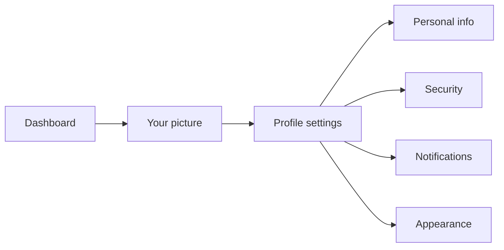
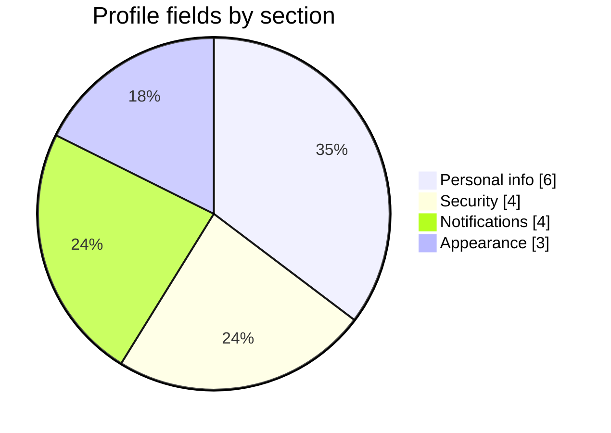
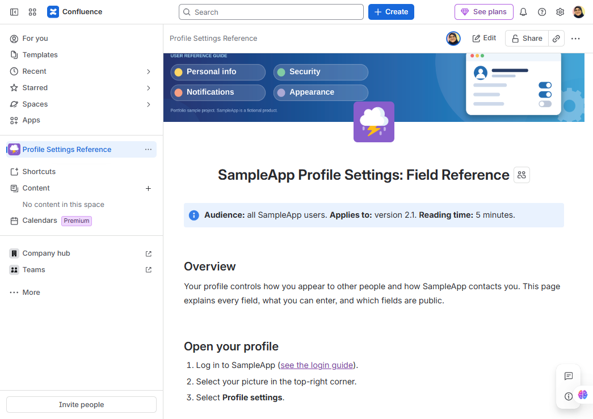
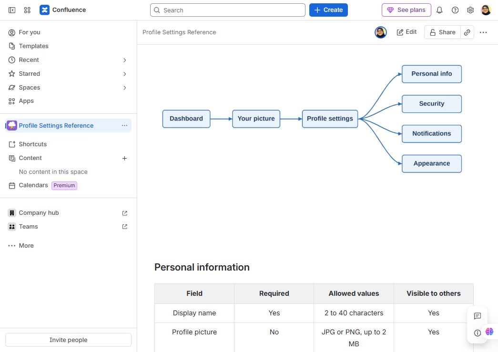
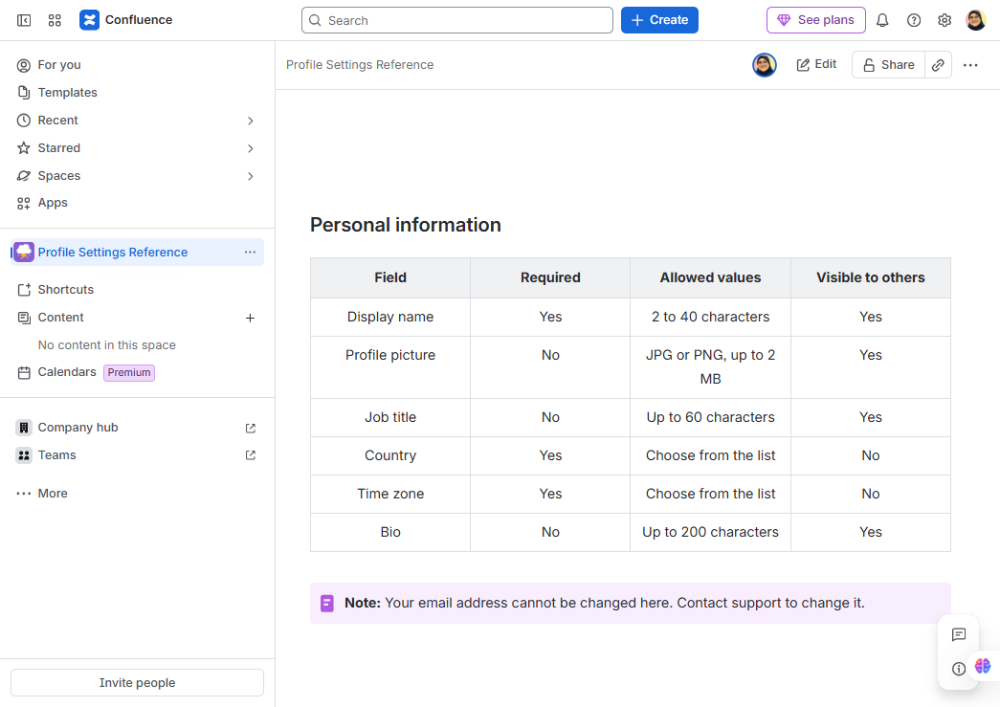
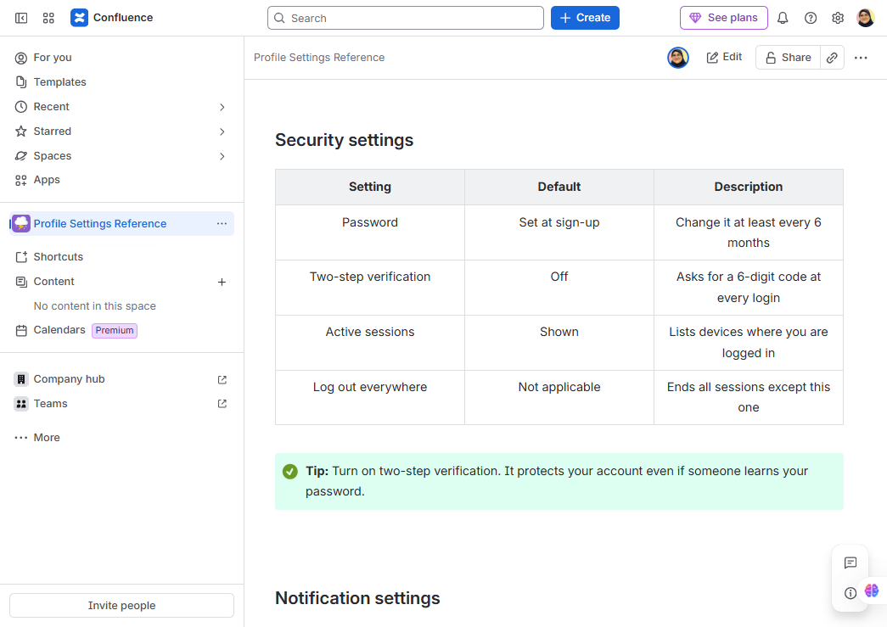
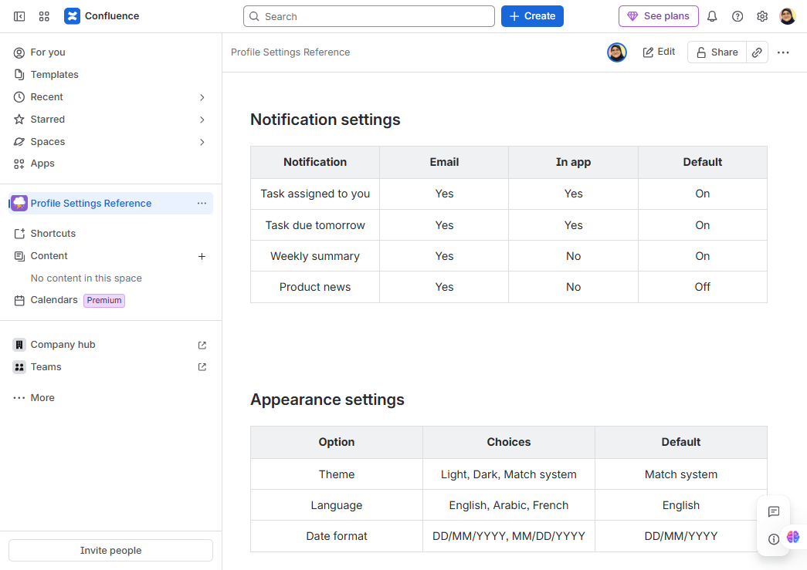
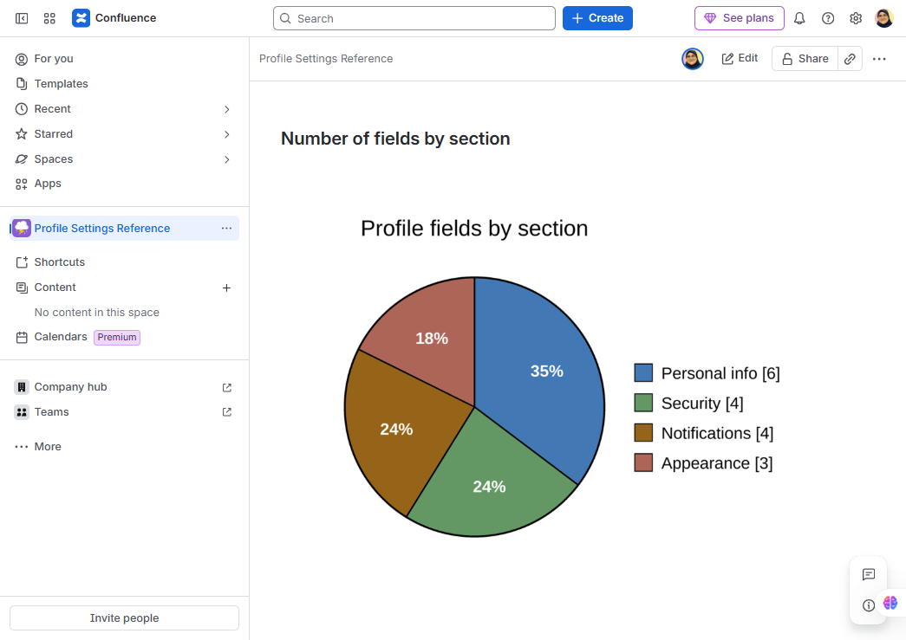
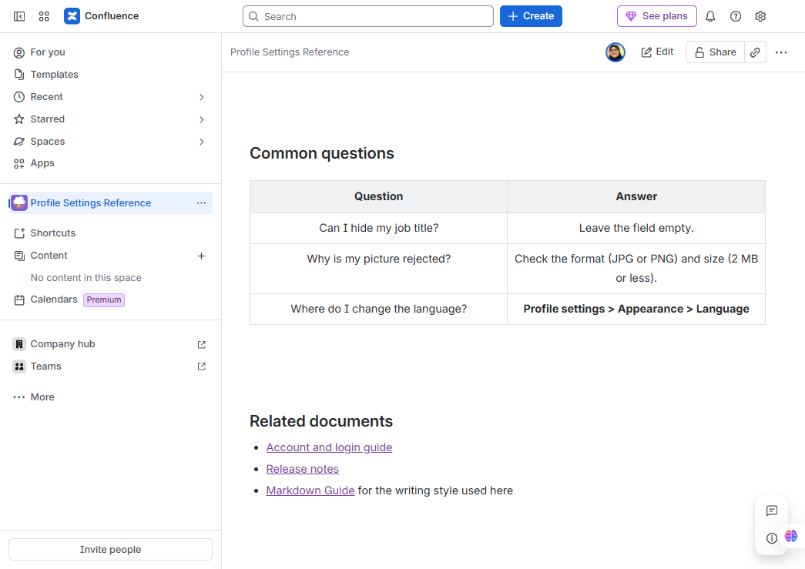

# SampleApp Profile Settings: Field Reference

> **Audience:** all SampleApp users.  **Applies to:** version 2.1.  **Reading time:** 5 minutes.

[View screenshots of the Confluence page](#screenshots-of-the-confluence-page)

## Overview
Your profile controls how you appear to other people and how SampleApp contacts you. This page explains every field, what you can enter, and which fields are public.

## Open your profile
1. Log in to SampleApp ([see the login guide](https://github.com/mai-aamer/account-and-login-guide)).
2. Select your picture in the top-right corner.
3. Select **Profile settings**.

## Personal information
| Field | Required | Allowed values | Visible to others |
|-------|:--------:|----------------|:-----------------:|
| Display name | Yes | 2 to 40 characters | Yes |
| Profile picture | No | JPG or PNG, up to 2 MB | Yes |
| Job title | No | Up to 60 characters | Yes |
| Country | Yes | Choose from the list | No |
| Time zone | Yes | Choose from the list | No |
| Bio | No | Up to 200 characters | Yes |

> **Note:** Your email address cannot be changed here. Contact support to change it.

## Security settings
| Setting | Default | Description |
|---------|---------|-------------|
| Password | Set at sign-up | Change it at least every 6 months |
| Two-step verification | Off | Asks for a 6-digit code at every login |
| Active sessions | Shown | Lists devices where you are logged in |
| Log out everywhere | Not applicable | Ends all sessions except this one |

> **Tip:** Turn on two-step verification. It protects your account even if someone learns your password.

## Notification settings
| Notification | Email | In app | Default |
|--------------|:-----:|:------:|---------|
| Task assigned to you | Yes | Yes | On |
| Task due tomorrow | Yes | Yes | On |
| Weekly summary | Yes | No | On |
| Product news | Yes | No | Off |

## Appearance settings
| Option | Choices | Default |
|--------|---------|---------|
| Theme | Light, Dark, Match system | Match system |
| Language | English, Arabic, French | English |
| Date format | DD/MM/YYYY, MM/DD/YYYY | DD/MM/YYYY |

## Number of fields by section

## Common questions
| Question | Answer |
|----------|--------|
| Can I hide my job title? | Leave the field empty. |
| Why is my picture rejected? | Check the format (JPG or PNG) and size (2 MB or less). |
| Where do I change the language? | **Profile settings > Appearance > Language** |

## Related documents
- [Account and login guide](https://github.com/mai-aamer/account-and-login-guide)
- [Release notes](https://github.com/mai-aamer/release-notes-v2-1-0)
- [Markdown Guide](https://www.markdownguide.org/) for the writing style used here

## Screenshots of the Confluence page

This guide was designed and published in Confluence. The screenshots below show the final page, from top to bottom.

